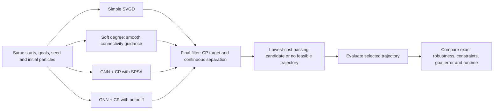

# Experimental SVGD + conformal GATv2 planner

Normal planning and visualization runs default to **`gnn_cp_autodiff`**.
Goal arrival is a **soft cost**, with `fixed_goal=false` explicitly recorded
in the double-integrator scenarios. Its default cost includes goal, motion,
collision, speed, smooth degree, terminal velocity, control effort, and the
continuous GNN robustness surrogate. Final acceptance requires both hard-graph CP bounds and hard separation
checks throughout the planned motion. Alternate methods require an explicit `--methods` selection.

The default demonstration now uses a **planar double integrator in SI units**.
Historical waypoint-only results are reproducible using
`planning/examples/legacy_waypoint_scenario.json`.

## Double-integrator dynamics and larger scenarios

The optimization variables are acceleration sequences, not independently
movable positions. Each robot starts at its configured position and velocity:

```text
p[k+1] = p[k] + dt*v[k] + 0.5*dt^2*u[k]
v[k+1] = v[k] + dt*u[k]
```

Acceleration is held constant over each interval. All candidate acceleration
vectors are projected onto `||u||_2 <= maximum_acceleration` at initialization
and after every update. Positions and velocities are generated by the dynamics
and cannot be overwritten to force an endpoint. The default input bound is
**1 m/s²**, sampling time **0.05 s**, and communication radius **3 m**.
This is a planar translational drone approximation, not attitude, motor, or
full quadrotor dynamics.

| Scenario | Start-to-goal translation | Steps | Horizon | Plotting workspace |
| --- | ---: | ---: | ---: | --- |
| `demo_scenario.json` / `double_integrator_large.json` | 10 m | 200 | 10 s | 20 × 10 m |
| `double_integrator_larger.json` | 25 m | 400 | 20 s | 35 × 10 m |
| `double_integrator_largest.json` | 50 m | 640 | 32 s | 60 × 10 m |

Starts are sampled within `[1,9] × [1,9]` m, subject to separation and degree
conditions, rather than the former 0.75-unit box. Prefixes of one reproducible
50-robot pool support different team sizes. The first ten robots form a compact
seed; the sampling constraints can concentrate robots, so the start box is a
sampling region, not a claim that every team fills the entire box. Goals move
the formation 10/25/50 m along x. Workspace bounds are reference extents and
are not hard walls or obstacle constraints. These are unobstructed formation
transfer demonstrations, not difficult obstacle-avoidance benchmarks.

Seeds use minimum-energy acceleration profiles with target terminal position
and zero terminal velocity; noise is added in control space. After projection,
arrival is encouraged by terminal costs, not imposed. Initial and goal
velocities default to `[0,0]` m/s. `maximum_speed = 3 m/s` remains a **soft**
cost separate from the **hard** acceleration-input bound of 1 m/s². Collision separation has a soft optimization penalty plus hard final
acceptance at 0.45 m. Goal completion and stopping at the goal remain soft.
`fixed_goal=True` is rejected for this model because clamping positions would
break the equations. All four planners retain the hard-graph CP filter; CP
acceptance alone is not full task success.

The autodiff planner backpropagates its GNN position gradient through the
rollout into acceleration controls. SPSA probes bounded acceleration sequences
and rolls them out before GNN scoring. There is no optimization loop that
changes positions independently of velocity/control states.

From `jax_GNN/`:

```bash
JAX_PLATFORMS=cuda .venv/bin/python -m planning \
  --scenario planning/examples/double_integrator_large.json \
  --robots 10 --particles 8 --iterations 5 \
  --methods gnn_cp_autodiff \
  --output reports/filtered_results/11-02/di_10m.json
```

Use `double_integrator_larger.json` or `double_integrator_largest.json` to
increase travel distance. Omit `--steps` to use each scenario's horizon. A
5-step horizon at dt=0.05 s is only 0.25 s; it cannot cover these transfers
from rest under the input bound. Solving cost grows with the number of graphs.
Use `--robots 50` for a larger team. The default method is `gnn_cp_autodiff`.
To compare all four, pass `--methods simple soft_degree gnn_cp_spsa gnn_cp_autodiff`.
Results include accelerations, velocities, their norms, terminal velocity,
and the original CP/trajectory metrics.

For a new single-plot video:

```bash
JAX_PLATFORMS=cuda .venv/bin/python -m planning.visualize_trajectory_updates \
  --scenario planning/examples/double_integrator_large.json \
  --robots 10 --particles 8 --iterations 5 --methods gnn_cp_autodiff \
  --record-only --output reports/visualizations/11-02/double_integrator_10m
.venv/bin/python -m planning.visualize_red_robots \
  --input reports/visualizations/11-02/double_integrator_10m
```

The red-robot renderer uses the constant-acceleration equations between
waypoints for these runs. Older waypoint videos retain linear interpolation.
The remaining sections also describe the legacy waypoint model and past runs;
use the scenario file above to distinguish dynamics-based experiments.

## Legacy waypoint demonstrations

The following examples describe the older waypoint-only experiments.


`planning.svgd_cp_planner` is an isolated prototype. A particle contains a short
sequence of 2-D waypoints for every robot. Each future waypoint is converted
to a directed communication graph. The optional `hard` mode preserves the
trained binary radius graph. The default `smooth` mode uses equation (7) of
Capelli and Sabattini, with `sigma = R^4 / ln(2)` by default, weighted degrees,
and a fixed dense off-diagonal edge index.

The experiment compares four SVGD objectives using identical initial particles:

| Run | Cost during SVGD | Purpose |
| --- | --- | --- |
| `simple` | Goal, motion, collision, and speed | No robustness objective |
| `soft_degree` | Simple costs plus a smooth degree-shortfall penalty | Differentiable connectivity guidance followed by the CP filter |
| `gnn_cp_spsa` | Soft-degree costs plus a GATv2/CP robustness-shortfall penalty | Learned robustness guidance using SPSA, followed by the CP filter |
| `gnn_cp_autodiff` | Soft-degree costs plus a continuous expected-class robustness penalty | Automatic position gradients through equation (7) and the frozen GNN, followed by the hard CP filter |

`soft_degree` is the name used in new terminal output, `--methods`, and JSON
result keys. Some earlier results used the temporary name `cp_penalty` for
this same algorithm. Existing saved files retain their original keys; the
comparison visualizer accepts either name. Earlier `gnn_cp` results correspond
to the current `gnn_cp_spsa` method.

For `soft_degree`, the optimization penalty uses equation-(7) connection weights
and weighted-degree shortfall in the default smooth mode. `degree_weight`
controls this penalty and `cp_weight` is zero. CP predictions are used for
acceptance, not to guide its updates. `gnn_cp_spsa` adds a discrete CP-bound
shortfall penalty controlled by `cp_weight`, with an SPSA position gradient.
`gnn_cp_autodiff` instead adds a continuous GNN surrogate controlled by
`cp_weight`, with automatic position gradients. All methods use hard graphs
for final CP acceptance.

All runs finish with joint CP and separation acceptance, independent of
`cp_weight` and `collision_weight`. With `collision_filter=true` (default),
CP-passing candidates must also maintain `minimum_separation` throughout
every motion interval, including the initial state.
Every candidate seen during optimization must have a conformal lower bound
at least `required_robustness` at every future waypoint. The planner returns
the lowest-cost candidate passing both checks, or `(None, report)` with
`status="no_feasible_trajectory"` if none pass. A scorer is required for every
run. This enforces the predicted-bound condition; the calibration limitations
below still apply to claims about actual robustness.

The `gnn_cp_spsa` run penalizes a trajectory if the **minimum conformal lower bound over its future
waypoints** is below `required_robustness`. For scenario files, this target is
derived from the user-supplied adversary bound as
`required_robustness = 2 * adversary_bound + 1`. `cp_kind="one_sided"` uses the
integer residual score; `cp_kind="lac"` uses the lower endpoint of the LAC set.
The discrete CP cost has no ordinary path derivative. The prototype estimates
the gradient of a Gaussian-smoothed CP cost with two-sided random probes and
applies an RBF SVGD update to the particles. All positive and negative SPSA
probes are submitted together for graph scoring, using bounded GNN minibatches.
This reduces repeated setup without reducing the number of probe graphs. The soft degree term provides a
differentiable connectivity signal. In smooth mode it uses the equation-(7)
adjacency; hard mode retains the original sigmoid degree heuristic.

In both planning modes, GNN/CP certification uses the binary hard-radius
support graph. The checkpoint and calibration records are binary graphs, and
exact r-robustness is defined on that same support. Smooth weighted adjacency
is used only as a differentiable planning surrogate; feeding it directly to
the binary-trained CP scorer would violate calibration exchangeability.

The GATv2 layer uses a scalar edge value both in its learned attention logit
and as a multiplicative attention prior. Thus zero-weight dense edges cannot
send messages. For binary compact graphs this layer is algebraically identical
to the original `jraphx` layer, so existing checkpoints load unchanged.

## Differentiable GNN planner

`gnn_cp_autodiff` uses equation (7) edge weights and weighted node degrees
throughout its optimization graph. It uses a fixed dense off-diagonal edge
index, frozen GNN parameters, and JAX arrays so gradients reach positions.
For each waypoint, its continuous guidance value is:

```text
continuous_lower = sum(class_index * GNN_probability[class_index]) - quantile
penalty = cp_weight * max(required_robustness - min_waypoint(continuous_lower), 0)^2
```

This is a surrogate, not a calibrated CP lower bound. It omits integer argmax,
ceil, and clipping from the optimization path. The waypoint minimum and squared
hinge are continuous and piecewise differentiable; JAX differentiates them.
The one-sided correction comes from the existing hard-graph calibration, and
is only an offset in this surrogate. LAC and infinite calibration quantiles
are unsupported by this new objective and produce an explicit error.

Every population still receives a separate hard-graph CP evaluation. Final
acceptance uses those hard bounds, while cost ranking uses the planner's own
optimization objective. The JSON `planner_report.cost` is that optimization
cost; `total_shared_objective` remains the existing common evaluation cost.
`planner_config` records settings separately for each method.

The binary-trained checkpoint is reused experimentally on fractional edge
weights for guidance; validate or retrain it for weighted inputs before
relying on the learned guidance. The final CP filter remains on binary graphs.
This change does not establish coverage for adaptively selected trajectories.

The implementation maps graphs/trajectories with activation recomputation to
bound reverse-mode memory, rather than keeping all dense graph activations on
the GPU together. Automatic differentiation eliminates SPSA probes but adds
GNN backpropagation; a speed improvement is not assumed.

Run only the new planner from `jax_GNN/`:

```bash
JAX_PLATFORMS=cuda .venv/bin/python -m planning \
  --scenario planning/examples/legacy_waypoint_scenario.json \
  --robots 50 --particles 16 --steps 50 --iterations 5 \
  --methods gnn_cp_autodiff \
  --output reports/filtered_results/11-01/cuda_autodiff_50robots_50steps.json
```

Omit `--methods` to run the default `gnn_cp_autodiff` planner. Pass multiple
method names to compare a subset, or
`--methods simple soft_degree gnn_cp_spsa gnn_cp_autodiff` for all four. The new planner always uses smooth connectivity,
even if `--connectivity-mode hard` selects hard-mode surrogates for other runs.

## Run the included demonstration

The included scenario reproducibly samples a pool of 50 robots with
**arbitrary coordinate units**. A compact 10-robot seed is generated first;
each additional robot is accepted only when it has at least
`required_robustness` neighbors within 80% of the communication radius. That
20% distance margin protects the required edges from small waypoint noise.
Goals apply one common translation to the starting formation, preserving all
pairwise distances and hard communication edges. `--robots N` selects the
same first N robots in every run. It is only for checking the pipeline, not a
real communication or flight setup.
From the repository root:

```bash
JAX_PLATFORMS=cuda .venv/bin/python -m planning \
  --scenario planning/examples/legacy_waypoint_scenario.json \
  --connectivity-mode hard \
  --output /tmp/svgd_results.json
```

Run the weighted mode with the default sigma:

```bash
JAX_PLATFORMS=cuda .venv/bin/python -m planning \
  --scenario planning/examples/legacy_waypoint_scenario.json \
  --connectivity-mode smooth \
  --output /tmp/svgd_smooth_results.json
```

Use `--connectivity-sigma VALUE` to override `R^4 / ln(2)`. Sigma must be
positive. These options can instead be stored as `connectivity_mode` and
`connectivity_sigma` in the scenario's `config` object.

The sampling interval is `sampling_time` (also accepted as `--dt`). The motion
limit is computed rather than entered independently:

```text
maximum_step = maximum_speed * sampling_time
```

For example, this runs 20 robots, a 30-step horizon, and `dt=0.1`:

```bash
JAX_PLATFORMS=cuda .venv/bin/python -m planning \
  --scenario planning/examples/legacy_waypoint_scenario.json \
  --robots 20 --steps 30 --dt 0.1 \
  --output reports/robots_20_steps_30_dt_0p1.json
```

Run the supplied sweep (5–50 robots in increments of 5;
10–50 steps in increments of 10; and `dt` 0.05, 0.1, and 0.2) in the default smooth mode with:

```bash
JAX_PLATFORMS=cuda bash planning/run_sweep.sh
```

Run the same grid in hard mode with:

```bash
CONNECTIVITY_MODE=hard JAX_PLATFORMS=cuda bash planning/run_sweep.sh
```

Results are stored in `reports/sweep/hard/` or `reports/sweep/smooth/`
according to `CONNECTIVITY_MODE`, so the two sweeps cannot overwrite each
other.

This launches 75 experiments, each containing the three legacy comparison methods, so
it can take a long time. Edit the three arrays at the top of `run_sweep.sh` to
reduce or densify the grid. With `F=2`, `r_required=5`; runs with 5–8 robots
are retained as infeasible controls and always report `Success=NO`.

The runner creates 16 initial trajectories around a straight-line route using
one fixed random seed. It gives the **same particles** to all four runs and
uses the same SVGD iteration count. The `simple` and `soft_degree` objectives use the GNN only to score candidates for the final filter, without a learned
gradient penalty. After filtering, every selected
trajectory is evaluated with the same graph scorer and, for at most 10 robots,
an exhaustive robustness checker. The table reports CP lower bound, exact
robustness, goal error, maximum waypoint step, minimum robot separation, and
cost under the same full objective. Runtime includes SVGD optimization and final filtering;
loading/calibrating the scorer and post-run evaluation are excluded. The JSON
output records all four selected trajectories and metrics. Use `--help` to
change particles, horizon, iterations, noise, seed, checkpoint, or calibration
file. Use `JAX_PLATFORMS=cpu` if CUDA is unavailable.

Unless `--noise` is supplied explicitly, initial waypoint noise is set to 10%
of `maximum_speed * sampling_time`. Use `--noise-fraction` to change that
fraction. This keeps random perturbations proportional to how far a robot is
allowed to move in one sampling interval.



This is an ablation of the added objectives, not a claim that lower training
cost alone produces a better plan. For a useful result, repeat the comparison
across realistic scenarios and seeds. The current one-sided CP quantile is
zero for the saved checkpoint, and the calibration data omit robustness-zero
graphs, so the reported lower bound is not a safety certificate.

To try your own setting, copy `planning/examples/legacy_waypoint_scenario.json`, replace `start`
and `goal` with your robots' 2-D positions (same number and order of robots),
and replace `config.communication_radius`, `minimum_separation`,
`maximum_speed`, `sampling_time`, and `adversary_bound` with your
measured/planned values. For
example, `adversary_bound: 2` produces `required_robustness: 5`.
The radius, separation, maximum step, start, and goal must use the same length
unit. The script will create the initial particles for you. For more than 10
robots, the exact robustness field is `null` because exhaustive verification
becomes expensive.

## Use the planner as a Python module

Example (from the repository root, with the project virtual environment):

```python
from pathlib import Path
import numpy as np
from planning.svgd_cp_planner import ConformalGraphScorer, PlannerConfig, plan

start = np.asarray(...)  # (robots, 2), in meters
goal = np.asarray(...)   # (robots, 2), in meters
particles = np.asarray(...)  # (particles, future_steps, robots, 2)

config = PlannerConfig(
    communication_radius=2.0,   # replace with measured radio/connectivity rule
    minimum_separation=0.5,
    maximum_speed=1.0,
    sampling_time=0.1,          # dt; maximum_step is 1.0 * 0.1 = 0.1
    required_robustness=5,      # 2F+1 for F=2
)
scorer = ConformalGraphScorer(
    Path("checkpoints/full_run_xK0R3I/new_gatv2.msgpack"),
    Path("calib_data.json"),
    config.cp_coverage,
    config.cp_kind,
)
waypoints, report = plan(start, goal, particles, scorer, config, iterations=20)
print(report)
```

This is a planning experiment, not a flight controller. The example distances
are placeholders. The repository has no authoritative dynamics, communication
radius, obstacle map, or planning scenario. The current calibration data have
no robustness-0 graphs, and the selected plan is chosen adaptively from many
GNN queries. Consequently the nominal CP coverage cannot be interpreted as a
guarantee for the selected trajectory. Validate the communication graph rule,
calibration distribution, collision/dynamics constraints, and selected plans
before integrating with a robot system.

## Differentiability and checkpoint limits

The differentiable path in smooth mode is `positions -> equation-(7)
adjacency -> weighted degree -> degree shortfall -> SVGD gradient`.

The hard CP path used by `gnn_cp_spsa` is not end-to-end differentiable. It contains
the hard support condition at `d = R`, class `argmax`, integer conformal
quantile/lower-bound lookup, a minimum over future steps, and particle `argmin`.
It also crosses host NumPy batching. `gnn_cp_spsa` therefore uses
two-sided SPSA probes for its hard-bound penalty. `gnn_cp_autodiff` bypasses
these discrete operations in its continuous optimization surrogate, while
retaining hard CP acceptance. Exact r-robustness evaluation is
combinatorial and is never differentiated.

The gradient audit found these concrete barriers:

| Pipeline operation | Gradient consequence |
| --- | --- |
| Hard `distance_squared <= R^2` and `np.nonzero` | Binary values and a dynamic sparse edge list; no position derivative |
| Host `np.asarray` plus Python graph-record/batch construction | Breaks JAX tracing before GNN inference |
| GNN class `argmax` | Converts continuous probabilities to an integer class |
| LAC comparison and first-true `argmax` | Boolean threshold and discrete set endpoint |
| One-sided CP `ceil`, `clip`, and integer cast | Discrete calibrated lookup/output |
| Minimum lower bound across waypoints | Selects a worst step after the already-discrete lookup |
| Exhaustive r-robustness subset/bit-count logic | Purely combinatorial evaluation |
| Final particle `argmin` | Discrete plan selection, not an optimization gradient |

The hard support test remains in equation (7), but clipping makes the two
pieces meet with zero first derivative at the boundary. It is therefore finite
and differentiable there in JAX while still providing no recovery gradient
from outside the radius.

Equation (7) has zero position gradient at `d = 0`, at `d = R`, and throughout
`d > R`; it cannot attract robots that are already outside communication
range. The branch is evaluated safely by clipping `R^2 - d^2` before `expm1`,
so the inactive exponential cannot overflow under JIT.

The bundled GATv2 checkpoint was trained only on binary edge attributes and
integer degrees. Loading it in smooth mode is structurally compatible, but its
predictions on fractional weights/degrees are out of distribution. Retraining
on weighted graphs, followed by fresh conformal calibration from the same
weighted-graph distribution, is recommended before interpreting those scores.

## Visualize trajectory updates and motion

Matplotlib is included in `requirements.txt`. The project virtual environment
already has Matplotlib and the local FFmpeg encoder is available.

From `jax_GNN/`, generate a four-method comparison with 10 robots, 10 future
waypoints, and 10 optimization updates:

```bash
JAX_PLATFORMS=cuda .venv/bin/python -m planning.visualize_trajectory_updates \
  --robots 10 --steps 10 --iterations 10
```

The default output directory is
`reports/visualizations/11-02/10robots_10steps/`. It contains:

- `optimization_updates.html`, `.mp4`, `.png`: actual particle populations
  across SVGD updates, following one fixed particle identity per method.
- `selected_motion.html`, `.mp4`, `.png`: selected trajectories played through
  the future waypoints, with hard communication links and per-step CP bounds.
- `planner_snapshots.npz`: all recorded populations, costs, and minimum CP
  bounds per candidate, plus selected trajectories.
- `metrics.json`: settings, per-step selected CP bounds, solving times, and
  selection reports.

Open the HTML files in a browser for play/pause and frame-slider controls.
The MP4 files are suitable for presentations. Each color consistently identifies
one robot. Dashed paths show the initial tracked trajectories in the update
view and the selected full plans in the playback view. Optimization updates
are distinct from sampling steps: robots are not executed during optimization.

Re-render the saved results and optionally open desktop Matplotlib windows:

```bash
.venv/bin/python -m planning.visualize_trajectory_updates --load --show
```

Use `--methods gnn_cp_autodiff` to record only one method, `--fps 1` to slow
playback, or `--output PATH` to keep experiments in separate folders. `--load`
reads settings from the saved files. There is no need for CUDA when re-rendering.

The presentation borrows the separate refinement/playback views of the
[distributed-MBD project](https://distributed-mbd.github.io/dmbd.github.io/)
and the method comparisons and playback diagnostics of the
[DPCBF project](https://www.taekyung.me/dpcbf). These references inform the
visualization only; no additional controller, obstacle model, or safety
certificate is introduced. The plots show sampled graphs, not certified motion
between waypoints.

### Single red-robot video with fixed goals

Use `--fixed-goal --record-only` with `planning.visualize_trajectory_updates`
to record candidates with final waypoints pinned to the goals, then render with
`python -m planning.visualize_red_robots`. The latter defaults to the saved
10-robot, 50-step run in
`reports/visualizations/11-02/10robots_50steps_fixed_goal/`. It displays red
numbered robots, green numbered goals, 50%-opacity dashed gray hard links,
exact graph robustness, and minimum degree. The CP label refers specifically
to stored waypoints. `fixed_goal` defaults to false for existing experiments;
it is explicitly enabled for this video. An infeasible fixed goal graph causes
the final filter to return no feasible trajectory.

### Show the dynamics, distance scale and communication radius

Add `--show-inputs` when rendering a recorded double-integrator run with
`planning.visualize_red_robots`. This uses the scenario's reference workspace,
shows a 3 m radius circle around robot 1, and draws the acceleration inputs as
orange arrows. Robot/goal dots remain red/green and communication links remain
50%-opacity dashed gray. See
[the 10 m example](../reports/visualizations/11-09/double_integrator_10m/README.md).

### Independently sampled robot goals

`planning/examples/double_integrator_random_goals.json` uses an independent
`random_goals` box and seed rather than `goal_translation`. Robot i is assigned
goal i from the new pool, so its displacement differs from other robots.
Starts are sampled from [2,10] × [2,10] m and goals from [70,78] × [2,10] m.
With the fixed seeds, individual travel distances are about 67–70 m. The
reference workspace is 80 × 12 m, R remains 3 m, and the 800-step horizon at
dt=0.05 s covers 40 seconds. Both endpoint formations use the same degree and
separation sampling conditions as other scenarios; the actual formations are
compact within their sampling boxes. Final CP filtering and soft collision
costs remain in use. This adds random robot-specific destinations, not
independent destinations scattered arbitrarily beyond communication range.

```bash
JAX_PLATFORMS=cuda .venv/bin/python -m planning.visualize_trajectory_updates \
  --scenario planning/examples/double_integrator_random_goals.json \
  --robots 10 --particles 8 --iterations 5 --methods gnn_cp_autodiff \
  --record-only --output reports/visualizations/11-09/double_integrator_random_goals
.venv/bin/python -m planning.visualize_red_robots \
  --input reports/visualizations/11-09/double_integrator_random_goals --show-inputs --fps 12
```

### Readable network close-up

For independently sampled goals around 20 m away, use
`double_integrator_random_goals_20m.json`, record with
`planning.visualize_trajectory_updates --record-only`, then render with
`planning.visualize_network_closeup --input OUTPUT_DIRECTORY`. This keeps the
robot network large in a 4 × 4 m following camera, with a small full-route map
and readable robustness/degree histories. See
[the example](../reports/visualizations/11-09/random_goals_20m_clear/README.md).

## Run 100 robots

The planning graph builder, scenario sampler and CLI now accept up to 100
robots. Use `planning/examples/double_integrator_100robots.json`, which sets
`random_positions.robot_count` to 100 and independently samples goals about
20 m away. Dynamics, dt=0.05 s, R=3 m, soft goals and hard acceleration norm
bound 1 m/s² match the smaller-team scenarios. The horizon is 320 steps/16 s.

From `jax_GNN/`, start with a small CUDA run:

```bash
JAX_PLATFORMS=cuda .venv/bin/python -m planning \
  --scenario planning/examples/double_integrator_100robots.json \
  --robots 100 --particles 2 --iterations 1 \
  --output reports/filtered_results/11-09/100robots_smoke.json
```

Use `--particles 8 --iterations 5` for a larger search after checking runtime.
The default method is `gnn_cp_autodiff`. GNN gradient work uses dense
100 × 100 weighted graphs at each waypoint, so cost grows faster than the
robot count. The saved results contain position waypoints, velocities,
accelerations and CP predictions. Exact robustness verification and the
numbered close-up visualizers remain limited to small teams (at most 10);
the 100-robot command above is a planning/state simulation, not a new video.

The checkpoint and calibration data were developed with at most 50 nodes.
Increasing the software limit does not validate CP coverage at 100 nodes.
The output marks `cp_scale_status` as experimental above that range; new
100-node evaluation/calibration data are needed before interpreting the
bounds as validated. The 26-class output and required-robustness range 0–25
are unchanged. The 100-robot scenario now requests r=21 via
`adversary_bound=10` and uses `robust_seed_size=22`. The seed setting is a
minimum-degree sampling condition; it does not prove 21-robustness. With
dt=0.05 s, retain its 320-step horizon: a 100-step horizon covers only 5 s
and is too short for these full transfers from rest.

### Fifty-robot close-up

Recording supports teams up to 100 with `--record-only`. The close-up viewer
can display the saved 50-robot result. For teams above ten, its chart shows CP
bounds and minimum degree instead of exact robustness. See
[the r=21 video](../reports/visualizations/11-09/50robots_r21/README.md) for
commands, settings and limitations.

## Collision-weight trials

Use `--collision-weight VALUE` with `python -m planning` to override the soft
collision cost without changing the scenario file. Goal arrival remains soft.
`python -m planning.tune_collision_weight` reuses the saved 50-robot r=21
comparison's exact geometry, initial particles, seed and optimization budget
while varying only that weight. It saves individual trials and CSV summaries.
The continuous separation checker minimizes pair distance within each
constant-acceleration interval, including interior stationary points.

The [trial report](../reports/trials/11-09/collision_weights_r21/REPORT.md)
records eighteen tested weights. None produced zero violations of the 0.45 m
separation threshold or zero body overlaps with radius 0.2 m. Weight 6,900 is
the lowest tested weight tied for the fewest violating pairs; the trajectories
remain unsafe. The default
collision weight stays at 10.

Use `--particles 50` or `--particles 100` with the tuning script to change
the population while retaining the saved geometry, seed, noise, horizon and
iteration count. Use separate output folders for each population. The default
trial policy includes the hard collision filter; `--legacy-cp-only` explicitly
enables CP-only acceptance for cost experiments.

`--compare-cp-only-output PATH` additionally saves the CP-only selection from
the same optimized populations while running the hard filter. It checks every
CP-passing candidate and records both selections, including null trajectories
when none pass the hard filter. This avoids duplicate GNN optimization:
neither final acceptance rule feeds back into particle updates. Both outputs
share the measured solve time, including collision screening. See the
[large-population comparison](../reports/trials/11-11/large_particle_collision_trials/REPORT.md)
for weights, collision counts, solver times and reproduction commands.

Large double-integrator populations use batches of eight for base-cost
gradients. The CP scorer builds at most about 256 graphs at a time, aligned
to its checkpoint's inference batch size. These bounds limit temporary
memory; every particle and waypoint is still evaluated. Add `--progress`
to the tuning command to print stages and CP/joint acceptance counts for
each population.

## Robot body radius

Double-integrator example scenarios now explicitly set `robot_radius=0.2` m
and a center-distance target of at least 0.45 m. For equal disks, contact
occurs at 0.4 m center distance, and the 0.45 m target leaves 0.05 m between
surfaces. The planner rejects a configured separation target smaller than
twice the body radius. Separation remains a soft cost during optimization. Candidates that violate
the hard final separation check are rejected. No contact-response dynamics
are simulated.

The close-up renderer now uses world-coordinate circles of radius 0.2 m, not
fixed-pixel markers. Historical data can be displayed using an explicit
`--robot-radius 0.2` override. Green goal points and small route-map dots remain
symbolic. The close-up reports negative surface gaps as BODY OVERLAP.

```bash
.venv/bin/python -m planning.visualize_network_closeup \
  --input reports/visualizations/11-09/50robots_r21 --robot-radius 0.2
```

`continuous_separation(..., robot_radius=0.2)` reports physical overlap counts
(<0.4 m) separately from safety-distance violations (<0.45 m). The extended
weight-sweep report includes both, using the user's radius assumption on the
recorded trajectories.

## Joint final CP and collision filter

Final acceptance now requires both the CP target and collision clearance.
`collision_filter=true` is the default in the API and example scenarios.
For each candidate, CP bounds must meet `required_robustness` at every future
waypoint, and all robot centers must stay at least `minimum_separation` apart.
For the current body radius of 0.2 m, the 0.45 m threshold includes a 0.05 m
surface gap. The check includes the initial configuration and the motion
between waypoints, not just the stored positions.

The double-integrator check minimizes pairwise separation over each quadratic
constant-acceleration interval using endpoints and stationary points. Legacy
waypoint plans are checked along straight-line segments. Sampled collisions
are rejected first to avoid unnecessary root calculations. Checks use a
1e-9 m comparison tolerance; this is numerical acceptance under the model,
not an execution/estimation safety certificate.

The collision penalty still guides optimization. Goal arrival stays soft
(`fixed_goal=false`), with no goal-distance acceptance threshold added. Only
candidates passing both final checks enter cost ranking or become the retained
incumbent. If none pass, the planner returns `None` with
`status="no_feasible_trajectory"`. No rejected fallback is returned as a plan.

Reports include `cp_passing_candidates`, `collision_rejected_candidates`,
`passing_candidates` (joint passes), and the accepted plan's `separation_check`.
Double-integrator reports also count rejection reasons. The terminal prints
the rejection counts when no candidate passes. This policy applies to all
four planners, regardless of penalty weights.

Old videos and the 18-weight report used CP-only acceptance and include
colliding trajectories. They are historical outputs, not accepted plans under
the new policy. The tuning helper now defaults to the joint policy and a new
output folder. Reproducing those historical CP-only trials requires the
explicit `--legacy-cp-only` option. Do not mix the two policies in one trial
folder. Accepted-motion visualizers stop with a clear message when no plan
passed; they do not render a rejected candidate as a successful trajectory.
