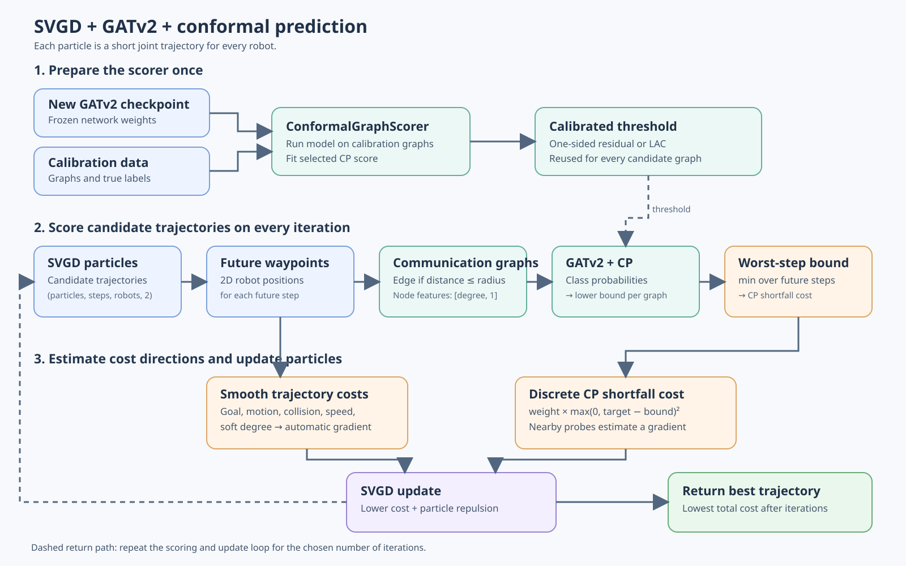
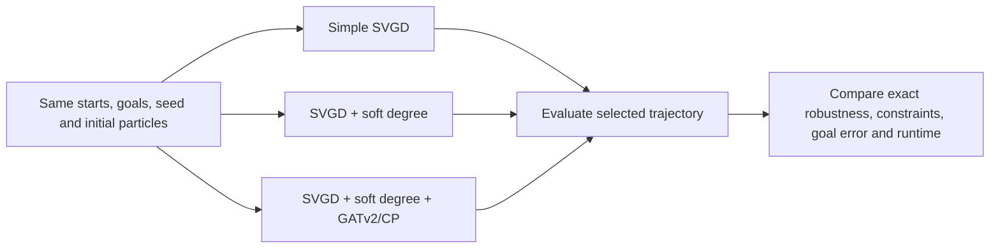

# Experimental SVGD + conformal GATv2 planner



`svgd_cp_planner.py` is an isolated prototype. A particle contains a short
sequence of 2-D waypoints for every robot. Each future waypoint is converted
to a directed communication graph using a supplied distance threshold. Its
node features and edge attributes match the New GATv2 training pipeline.

The experiment compares three SVGD objectives using identical initial particles:

| Run | Cost during SVGD | Purpose |
| --- | --- | --- |
| `simple` | Goal, motion, collision, and speed | No robustness objective |
| `soft_degree` | Simple costs plus a smooth degree-shortfall penalty | Cheap connectivity heuristic |
| `gnn_cp` | Soft-degree costs plus a GATv2/CP robustness-shortfall penalty | Test the added learned signal |

The GNN+CP run penalizes a trajectory if the **minimum conformal lower bound over its future
waypoints** is below `required_robustness`. `cp_kind="one_sided"` uses the
integer residual score; `cp_kind="lac"` uses the lower endpoint of the LAC set.
The discrete CP cost has no ordinary path derivative. The prototype estimates
the gradient of a Gaussian-smoothed CP cost with two-sided random probes and
applies an RBF SVGD update to the particles. The soft degree term provides a
differentiable connectivity signal when random probes do not cross an edge
threshold.

## Run the included demonstration

The included scenario has 10 robots and **arbitrary coordinate units**. It is
only for checking the pipeline, not a real communication or flight setup.
From the repository root:

```bash
JAX_PLATFORMS=cuda .venv/bin/python run_svgd_experiment.py \
  --scenario planning/examples/demo_scenario.json \
  --output /tmp/svgd_results.json
```

The runner creates 16 initial trajectories around a straight-line route using
one fixed random seed. It gives the **same particles** to all three runs and
uses the same SVGD iteration count. The simple and soft-degree objectives do
not query the GNN during optimization. After optimization, every selected
trajectory is evaluated with the same graph scorer and, for at most 10 robots,
an exhaustive robustness checker. The table reports CP lower bound, exact
robustness, goal error, maximum waypoint step, minimum robot separation, and
cost under the same full objective. Runtime measures SVGD optimization only;
loading/calibrating the scorer and post-run evaluation are excluded. The JSON
output records all three selected trajectories and metrics. Use `--help` to
change particles, horizon, iterations, noise, seed, checkpoint, or calibration
file. Use `JAX_PLATFORMS=cpu` if CUDA is unavailable.



This is an ablation of the added objectives, not a claim that lower training
cost alone produces a better plan. For a useful result, repeat the comparison
across realistic scenarios and seeds. The current one-sided CP quantile is
zero for the saved checkpoint, and the calibration data omit robustness-zero
graphs, so the reported lower bound is not a safety certificate.

To try your own setting, copy `planning/examples/demo_scenario.json`, replace `start`
and `goal` with your robots' 2-D positions (same number and order of robots),
and replace `config.communication_radius`, `minimum_separation`,
`maximum_step`, and `required_robustness` with your measured/planned values.
The radius, separation, maximum step, start, and goal must use the same length
unit. The script will create the initial particles for you. For more than 10
robots, the exact robustness field is `null` because exhaustive verification
becomes expensive.

## Use the planner as a Python module

Example (from the repository root, with the project virtual environment):

```python
from pathlib import Path
import numpy as np
from svgd_cp_planner import ConformalGraphScorer, PlannerConfig, plan

start = np.asarray(...)  # (robots, 2), in meters
goal = np.asarray(...)   # (robots, 2), in meters
particles = np.asarray(...)  # (particles, future_steps, robots, 2)

config = PlannerConfig(
    communication_radius=2.0,   # replace with measured radio/connectivity rule
    minimum_separation=0.5,
    maximum_step=1.0,
    required_robustness=2,
)
scorer = ConformalGraphScorer(
    Path("checkpoints/full_run_xK0R3I/new_gatv2.msgpack"),
    Path("calib_data.json"),
    config.cp_coverage,
    config.cp_kind,
)
waypoints, report = plan(start, goal, particles, scorer, config, iterations=20)
print(report)
```

This is a planning experiment, not a flight controller. The example distances
are placeholders. The repository has no authoritative dynamics, communication
radius, obstacle map, or planning scenario. The current calibration data have
no robustness-0 graphs, and the selected plan is chosen adaptively from many
GNN queries. Consequently the nominal CP coverage cannot be interpreted as a
guarantee for the selected trajectory. Validate the communication graph rule,
calibration distribution, collision/dynamics constraints, and selected plans
before integrating with a robot system.
